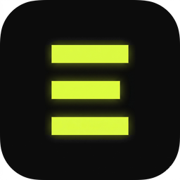
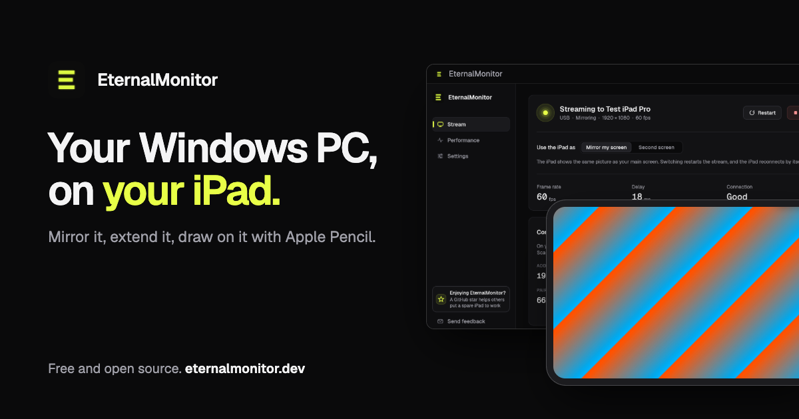
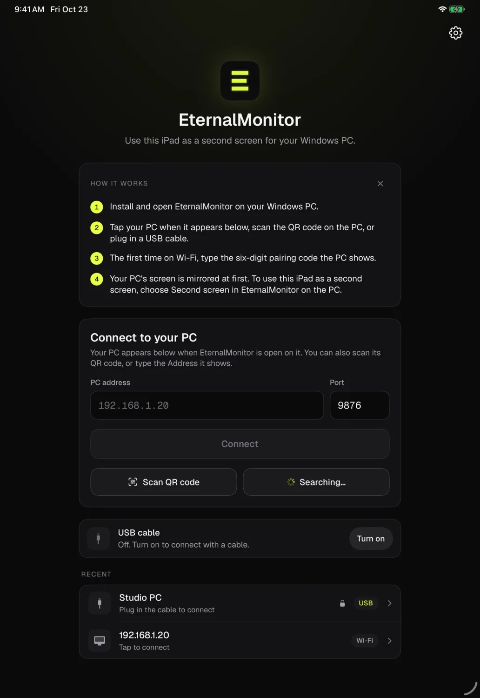
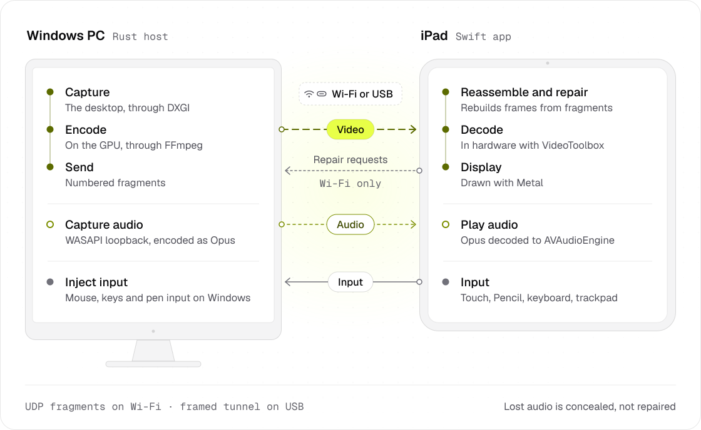

<div align="center">

[English](../README.md) · [Español](README.es.md) · [العربية](README.ar.md) · [简体中文](README.zh-Hans.md) · **हिन्दी** · [Русский](README.ru.md) · [日本語](README.ja.md) · [Português (Brasil)](README.pt-BR.md) · [Français](README.fr.md) · [Deutsch](README.de.md) · [한국어](README.ko.md)

*इस पृष्ठ और [अंग्रेज़ी README](../README.md) में अंतर होने पर अंग्रेज़ी संस्करण नवीनतम है।*



# EternalMonitor

अपने Windows डेस्कटॉप को Wi-Fi या USB से iPad पर मिरर करें या बढ़ाएँ,<br>
और PC को टच, कीबोर्ड या Apple Pencil से नियंत्रित करें।

[](https://github.com/sidebandstudio/EternalMonitor/releases/latest)
[](https://github.com/sidebandstudio/EternalMonitor/actions/workflows/ci.yml)
[](../LICENSE)
[](#डाउनलोड-करें)
[](https://eternalmonitor.dev)
[](https://discord.gg/Xc7NykBZ6z)

[डाउनलोड करें](#डाउनलोड-करें) · [सेटअप गाइड](../SETUP.md) · [ज्ञात समस्याएँ](https://eternalmonitor.dev/known-issues.html) · [वेबसाइट](https://eternalmonitor.dev) · [रिलीज़ नोट्स](../RELEASE_NOTES.md) · [Discord](https://discord.gg/Xc7NykBZ6z)

</div>

<p align="center">
  
</p>

EternalMonitor आपके Windows डेस्कटॉप को iPad पर स्ट्रीम करता है और आपका इनपुट वापस भेजता है। एक छोटा Windows ऐप स्क्रीन कैप्चर करता है और आपके ग्राफ़िक्स कार्ड पर उसे एनकोड करता है। iPad ऐप हार्डवेयर में वीडियो डिकोड करके Metal से दिखाता है, और हर टैप, कीस्ट्रोक और Pencil स्ट्रोक PC पर वापस जाता है। यह मुफ़्त और MIT License के तहत ओपन सोर्स है, और इसके लिए खाते की ज़रूरत नहीं है।

## सुविधाएँ



- **बढ़ाएँ या मिरर करें।** iPad को अपने मॉनिटर के बगल में अतिरिक्त डिस्प्ले बनाएँ या किसी भी स्क्रीन को मिरर करें। iPad के डिस्कनेक्ट होने के 10 सेकंड बाद अतिरिक्त डिस्प्ले हट जाता है। जल्दी दोबारा कनेक्ट करने पर वही डिस्प्ले इस्तेमाल होता है और Windows में बेकार मॉनिटर नहीं रह जाता।
- **Wi-Fi या USB।** अपने घरेलू नेटवर्क पर स्ट्रीम करें या अधिक स्थिर तस्वीर के लिए केबल लगाएँ, जिससे iPad भी चार्ज होता है। केबल चालू Wi-Fi सत्र संभाल लेती है और उसे निकालने पर Wi-Fi फिर इस्तेमाल होता है।
- **टच, कीबोर्ड और पॉइंटर।** क्लिक करने के लिए टैप करें, ड्रैग करें, दो उँगलियों से स्क्रॉल करें और राइट-क्लिक के लिए दबाकर रखें। हार्डवेयर कीबोर्ड, ट्रैकपैड और माउस भी काम करते हैं, साथ में स्टिकी मॉडिफ़ायर और मिडिल-क्लिक भी।
- **Apple Pencil असली पेन की तरह।** Windows को Windows Ink का दबाव और झुकाव मिलता है, और किसी भी मॉनिटर व्यवस्था में पेन का निशान नोक के नीचे पड़ता है। **ड्रॉइंग मोड** (Drawing mode) कैनवास पर हथेली को अनदेखा करता है और Clip Studio Paint अपनी "Tablet PC" सेटिंग के साथ काम करता है।
- **फ़िट या फ़िल।** **फ़िट** (Fit) पूरी PC तस्वीर दिखाता है, आकार अलग होने पर खाली पट्टियों के साथ। **फ़िल** (Fill) iPad की पूरी स्क्रीन इस्तेमाल करता है और बाहर के किनारे काट देता है।
- **PC ऑडियो।** आवाज़ iPad पर Opus में चलती है, जिटर बफ़र और लॉस कन्सीलमेंट के साथ। वीडियो रोके बिना आप इसे म्यूट कर सकते हैं।
- **Wi-Fi पर खोए डेटा की मरम्मत।** पैकेट खोने पर iPad तुरंत वह टुकड़ा फिर माँगता है, इसलिए एक पैकेट खोने से शायद ही कोई फ़्रेम छूटता है। बिटरेट 4 से 50 Mbps के बीच बदलता है।
- **आपका GPU काम करता है।** NVIDIA NVENC, AMD AMF या Intel Quick Sync डिफ़ॉल्ट रूप से H.264 या आपकी पसंद पर HEVC को 30, 60, 90 या 120 fps पर एनकोड करते हैं।
- **पेयरिंग।** पहली Wi-Fi कनेक्शन पर छह अंकों का कोड या QR स्कैन चाहिए। उसके बाद iPad PC को याद रखता है। USB के लिए कोड नहीं चाहिए।
- **फिर चालू होता है और समस्या बताता है।** लॉक स्क्रीन, डिस्प्ले बदलने या स्ट्रीम दोबारा शुरू होने के बाद तस्वीर अपने आप लौटती है। समस्या होने पर दोनों ऐप बताते हैं कि क्या हुआ और क्या करें, और **फ़ीडबैक भेजें** (Send feedback) आपके सेटअप की जानकारी भरकर स्टूडियो को ईमेल लिखता है।
- **एक क्लिक में अपडेट।** नया संस्करण आने पर पॉपअप बताता है। Windows पर **अभी अपडेट करें** (Update now) डाउनलोड जाँचता है और एक Windows प्रॉम्प्ट के साथ इंस्टॉल करता है; iPad ऐप TestFlight खोलता है। Windows ऐप बिना कंसोल विंडो के चलता है।

<br clear="right">

## डाउनलोड करें

| | ज़रूरतें | डाउनलोड |
| --- | --- | --- |
| **Windows** | Windows 10 संस्करण 1809 या नया, या Windows 11, 64-bit, NVIDIA, AMD या Intel ग्राफ़िक्स के साथ | [EternalMonitor-Setup.exe](https://github.com/sidebandstudio/EternalMonitor/releases/tag/v0.3.3) (v0.3.3 वर्तमान स्थिर संस्करण) |
| **iPad** | iPadOS 17 या नया | [TestFlight v0.3.3, build 364](https://testflight.apple.com/join/ppc9QfXc)। सार्वजनिक बीटा खुला है: TestFlight इंस्टॉल करें, फिर iPad पर लिंक खोलें। |

eternalmonitor.dev/download.html पर दिए Windows और iPad संस्करण इंस्टॉल करें। संस्करण संख्या अलग होने पर भी ये साथ काम करते हैं। पुराने v0.1 रिलीज़ अलग प्रोटोकॉल इस्तेमाल करते हैं और v0.3 iPad ऐप से कनेक्ट नहीं हो सकते।

परीक्षण कर रहे हैं? बग और फ़ीडबैक [डाउनलोड पृष्ठ के फ़ॉर्म](https://eternalmonitor.dev/download.html#feedback) से भेजें, जो hello@sideband.studio को ईमेल करता है, [GitHub issue](https://github.com/sidebandstudio/EternalMonitor/issues/new/choose) खोलें या [Sideband Discord](https://discord.gg/Xc7NykBZ6z) पर बताएँ।

इंस्टॉलर पर अभी code signature नहीं है, इसलिए Windows SmartScreen चलाने से पहले पूछता है। फ़ाइल का SHA-256 [रिलीज़ पृष्ठ](https://github.com/sidebandstudio/EternalMonitor/releases) से मिलाने के बाद ही **अधिक जानकारी** (More info), फिर **फिर भी चलाएँ** (Run anyway) चुनें।

USB के लिए Apple का मुफ़्त [Apple Devices](https://apps.microsoft.com/detail/9np83lwlpz9k) ऐप भी चाहिए, जिसे स्ट्रीम करते समय खुला रखें। Windows केबल से iPad तक केवल इसी के ज़रिए पहुँच सकता है, और EternalMonitor उसके बंद या अनुपस्थित होने पर बताता है। Apple Devices के लिए Windows 10 संस्करण 22H2 (build 19045) या Windows 11 चाहिए, इसलिए पुराने Windows 10 पर Wi-Fi से कनेक्ट करें।

**इसके बाद [सेटअप गाइड](../SETUP.md) का पालन करें।** इसमें दोनों ऐप इंस्टॉल करने, पेयरिंग, USB, बढ़े हुए डिस्प्ले और ड्रॉइंग के चरण हैं, स्क्रीन पर दिखने वाले बटन के नामों के साथ।

## स्थिति

v0.3.3 उन PC पर **दूसरी स्क्रीन** (Second screen) ठीक करता है जहाँ यह शुरू नहीं होती थी, अक्सर Intel और NVIDIA ग्राफ़िक्स वाले लैपटॉप पर। दूसरी स्क्रीन शुरू होते समय iPad पर PC की मुख्य स्क्रीन दिखती है और PC की स्क्रीन अब बार-बार नहीं झपकती। Windows 0.3.3 के साथ iPad को TestFlight v0.3.3, build 364 पर अपडेट करें।

Windows और iPad डायग्नोस्टिक्स में डिवाइस विवरण, ऐप की त्रुटियाँ और स्ट्रीम के आँकड़े होते हैं। रिपोर्ट में PC और iPad के नाम, ऑडियो डिवाइस के नाम और नेटवर्क पते होते हैं, लेकिन स्क्रीन की सामग्री, ऑडियो और पेयरिंग क्रेडेंशियल नहीं होते। **सेटिंग्स** (Settings) में स्वचालित साझाकरण बंद करें। डायग्नोस्टिक्स 30 दिन तक रखे जाते हैं और पहले भी हटाए जा सकते हैं। हटाए गए या समय सीमा पार कर चुके डायग्नोस्टिक्स दैनिक बैकअप में 7 और दिन तक रह सकते हैं। [स्वचालित डायग्नोस्टिक्स](../SETUP.md#automatic-diagnostics) और [गोपनीयता सूचना](https://eternalmonitor.dev/privacy.html) देखें। iPad पर रिपोर्ट कॉपी या एक्सपोर्ट करने के लिए **सेटिंग्स** (Settings) > **सहायता** (Support) > **डायग्नोस्टिक्स** (Diagnostics) खोलें।

रिलीज़ जाँच Windows, macOS और iPad सिमुलेटर पर पास हुई। ज्ञात समस्याएँ [ज्ञात समस्याएँ](https://eternalmonitor.dev/known-issues.html) पृष्ठ पर हैं और पहले के वास्तविक डिवाइस परिणाम [docs/hardware-verification.md](../docs/hardware-verification.md) में हैं।

ज्ञात सीमाएँ:

- स्ट्रीम एन्क्रिप्टेड नहीं है। पेयरिंग दूसरे डिवाइस को बाहर रखती है, इसलिए भरोसेमंद नेटवर्क इस्तेमाल करें, जैसे अपना घरेलू Wi-Fi।
- केवल Windows ऐप होस्ट है। डेवलपमेंट के लिए होस्ट macOS पर बनता है, लेकिन वहाँ स्क्रीन के बजाय परीक्षण पैटर्न स्ट्रीम करता है।
- Apple Pencil (USB-C) में दबाव सेंसर नहीं है, इसलिए उसके स्ट्रोक की चौड़ाई एक जैसी रहती है।

[ज्ञात समस्याएँ](https://eternalmonitor.dev/known-issues.html) हर ज्ञात समस्या और उसके समाधान को सूचीबद्ध करता है।

## यह कैसे काम करता है

<picture>
  <source media="(prefers-color-scheme: dark)" srcset="../docs/assets/readme/how-it-works-dark.svg">
  
</picture>

Windows होस्ट Rust में लिखा है। यह DXGI से डेस्कटॉप कैप्चर करता है, FFmpeg के ज़रिए GPU पर एनकोड करता है और हर फ़्रेम को क्रमांकित UDP टुकड़ों में भेजता है। USB पर वही संदेश Apple की डिवाइस सेवा की फ़्रेम वाली टनल से जाते हैं। iPad ऐप नेटिव Swift में है। यह टुकड़े जोड़ता है, VideoToolbox से डिकोड करता है और Metal से रेंडर करता है। Wi-Fi पर यह गायब टुकड़े भी माँगता है। PC ऑडियो WASAPI से कैप्चर होकर Opus में भेजा जाता है और iPad खोए ऑडियो को दोबारा माँगने के बजाय उसकी कमी छिपाता है। इनपुट और रिसीवर रिपोर्ट उसी सत्र में वापस जाते हैं और होस्ट उन रिपोर्ट से बिटरेट बदलता है।

[ARCHITECTURE.md](../ARCHITECTURE.md) पाइपलाइन और प्रोटोकॉल v2 का वर्णन करता है और [docs/decisions.md](../docs/decisions.md) हर हिस्से के काम करने के तरीके का कारण बताता है।

## सोर्स से बिल्ड करें

वर्कस्पेस में Rust होस्ट (`host/`), प्रोटोकॉल crate `eternal-wire` (`proto/`) और Swift iPad ऐप (`ios/`) हैं।

<details>
<summary><b>Windows होस्ट</b></summary>

ज़रूरतें: Windows 10 संस्करण 1809 या नया, Rust 1.98.0 (`rust-toolchain.toml` में निर्धारित, MSVC), FFmpeg **7.1 shared** SDK और bindgen के लिए LLVM/libclang।

```powershell
# Point the build at your FFmpeg 7.1 shared SDK (the folder with bin\avcodec-*.dll)
$env:FFMPEG_DIR = "C:\ffmpeg"
cargo build --release -p eternal-host
.\target\release\eternal-host.exe          # optional port argument, default 9876
```

होस्ट Windows GUI प्रोग्राम है, इसलिए कंसोल विंडो नहीं खोलता। टर्मिनल से शुरू करने पर वह वहाँ लॉग लिखता है, लेकिन प्रॉम्प्ट तुरंत लौट आता है; `cargo run -p eternal-host` उसके लिए इंतज़ार करता है। `ETERNAL_HEADLESS=1` और रीडायरेक्टेड आउटपुट (`> host.log`) के साथ उसे अपना कंसोल मिलता है, इसलिए टर्मिनल का Ctrl+C उस तक नहीं पहुँचता: उस कंसोल की विंडो में Ctrl+C दबाएँ या Task Manager इस्तेमाल करें। `scripts\win\Stop-Host.ps1` केवल `remote.sh run-host` से शुरू हुए होस्ट रोकता है।

`scripts\build-installer.ps1` Inno Setup और उसी `FFMPEG_DIR` से पूरा Setup.exe बनाता है। `scripts\package.ps1` एक साधारण zip बनाता है।

</details>

<details>
<summary><b>macOS डेवलपमेंट प्रक्रिया</b> (Windows की ज़रूरत नहीं)</summary>

macOS पर होस्ट स्क्रीन कैप्चर की जगह कृत्रिम परीक्षण पैटर्न इस्तेमाल करता है। प्रोटोकॉल, एनकोडर, ट्रांसपोर्ट और सुपरवाइज़र वास्तव में चलते हैं।

```bash
brew install ffmpeg@7 pkgconf xcodegen
export PKG_CONFIG_PATH=/opt/homebrew/opt/ffmpeg@7/lib/pkgconfig
cargo test --workspace          # unit, golden-vector and synthetic end-to-end tests
ETERNAL_CAPTURE=synthetic cargo run -p eternal-host
```

अगर Xcode के कमांड लाइन टूल चयनित डेवलपर डायरेक्टरी हैं, तो Xcode कमांड से पहले `DEVELOPER_DIR=/Applications/Xcode.app/Contents/Developer` लगाएँ।

</details>

<details>
<summary><b>iPad ऐप</b></summary>

```bash
cd ios
xcodegen generate               # project.yml is the source of truth
xcodebuild test -project EternalMonitor.xcodeproj -scheme EternalMonitor \
  -destination 'platform=iOS Simulator,name=iPad Pro 11-inch (M4)'
```

वास्तविक iPad पर चलाने के लिए Xcode में बना हुआ प्रोजेक्ट खोलें और अपनी signing team चुनें।

</details>

<details>
<summary><b>एंड-टू-एंड परीक्षण</b></summary>

```bash
./scripts/e2e_ios.sh              # synthetic host to the iPad simulator, H.264
EM_CODEC=hevc ./scripts/e2e_ios.sh
scripts/test_ios.sh               # iPad unit and UI tests
scripts/e2e_matrix.sh             # UDP, loss, burst, USB, audio, pairing, input, lifecycle
scripts/soak.sh 1800              # 30-minute frame-rate and memory check
```

हर पंक्ति डिकोडेड फ़्रेम रेट (कम से कम 55 fps), ड्रॉप, मरम्मत और रेंडर किए पिक्सेल जाँचती है। `e2e_matrix.sh --real` Windows हार्डवेयर पंक्तियाँ `scripts/win/` के रनर से चलाता है; पहले [scripts/win/README.md](../scripts/win/README.md) पढ़ें। CI हर pull request पर Linux, macOS और Windows में Rust suites, iPad परीक्षण और स्ट्रीमिंग सिस्टम परीक्षण चलाता है।

</details>

<details>
<summary><b>होस्ट के environment variables</b></summary>

| Variable | Effect |
| --- | --- |
| `ETERNAL_ENCODER` | एनकोडर तय करें (`h264_nvenc`, `h264_amf`, `h264_qsv`, `libx264`) |
| `ETERNAL_HEVC` | `1` या `0` HEVC प्राथमिकता बदलता है |
| `ETERNAL_FPS` | होस्ट फ़्रेम रेट बदलें; iPad की प्राथमिकता अब भी अधिकतम सीमा तय करती है |
| `ETERNAL_INPUT` | एनकोडर इनपुट: `yuv420` (डिफ़ॉल्ट), `auto` या `bgra` |
| `ETERNAL_MAX_DGRAM` | मीडिया datagram का आकार, 576 से 1400 bytes |
| `ETERNAL_CAPTURE` | `synthetic` DXGI की जगह बनाया हुआ परीक्षण पैटर्न इस्तेमाल करता है |
| `ETERNAL_AUDIO` | `synthetic` निश्चित ऑडियो परीक्षण स्रोत चुनता है |
| `ETERNAL_HEADLESS` | `1` बिना विंडो के चलाता है; Ctrl+C साफ़ तरीके से बंद करता है |
| `ETERNAL_ABR` | `0` अनुकूली बिटरेट बंद करता है |
| `ETERNAL_VDD_TIMEOUT_SECS` | वर्चुअल डिस्प्ले जुड़ने का इंतज़ार (डिफ़ॉल्ट 30) |
| `ETERNAL_AMF_DIAG` | `1` AMF बिटस्ट्रीम डायग्नोस्टिक्स लिखता है |
| `ETERNAL_LEGACY_PTS` | `1` पुराने फ़्रेम काउंटर टाइमस्टैम्प लौटाता है |
| `ETERNAL_DROP`, `ETERNAL_REORDER`, `ETERNAL_JITTER_MS` | केवल परीक्षण: लॉस, क्रम परिवर्तन या जिटर डालें |
| `ETERNAL_USB_DIRECT` | केवल परीक्षण: USB टनल की जगह TCP endpoint |

</details>

## दस्तावेज़

ये दस्तावेज़ अंग्रेज़ी में हैं।

| दस्तावेज़ | विषय |
| --- | --- |
| [SETUP.md](../SETUP.md) | सभी के लिए चरण-दर-चरण सेटअप, USB और ड्रॉइंग सहित |
| [ज्ञात समस्याएँ](https://eternalmonitor.dev/known-issues.html) | ज्ञात समस्याएँ और उनके समाधान (`docs/known-issues.html`) |
| [गोपनीयता](https://eternalmonitor.dev/privacy.html) | ऐप क्या और क्यों भेजते हैं, कितने समय रखा जाता है और कैसे बंद करें (`docs/privacy.html`) |
| [ARCHITECTURE.md](../ARCHITECTURE.md) | पाइपलाइन, प्रोटोकॉल v2 और हर घटक |
| [docs/decisions.md](../docs/decisions.md) | माप के साथ डिज़ाइन के कारण |
| [docs/pencil-drawing.md](../docs/pencil-drawing.md) | Apple Pencil, Windows Ink और Clip Studio Paint |
| [docs/pairing.md](../docs/pairing.md), [docs/keyboard-input.md](../docs/keyboard-input.md), [docs/host-settings.md](../docs/host-settings.md), [docs/audio-codec.md](../docs/audio-codec.md) | सुविधाओं का विवरण |
| [docs/hardware-verification.md](../docs/hardware-verification.md) | रिलीज़ परीक्षण का रिकॉर्ड और व्यावहारिक जाँच सूची |
| [docs/beta-testing.md](../docs/beta-testing.md) | बीटा चलाना: TestFlight, signing और क्या जाँचना है |
| [docs/design.md](../docs/design.md) | ऐप और वेबसाइट का साझा रूप |
| [RELEASE_NOTES.md](../RELEASE_NOTES.md) | हर संस्करण में बदलाव |

## योगदान

ट्रांसपोर्ट और एनकोडर से लेकर रेंडरिंग और दस्तावेज़ तक, योगदान का स्वागत है। pull request खोलने से पहले [CONTRIBUTING.md](../CONTRIBUTING.md) पढ़ें। पहले किसी विचार पर बात करने के लिए [Sideband Discord](https://discord.gg/Xc7NykBZ6z) पर पूछें।

## संपर्क

सवाल, सेटअप में मदद और विचारों के लिए [Sideband Discord](https://discord.gg/Xc7NykBZ6z) पर आएँ। आप [hello@sideband.studio](mailto:hello@sideband.studio) पर ईमेल भी कर सकते हैं।

बग मिला? दोनों ऐप के संस्करण और होस्ट लॉग के साथ [issue खोलें](https://github.com/sidebandstudio/EternalMonitor/issues/new/choose)। सुरक्षा समस्याएँ Discord या issue में नहीं, बल्कि [SECURITY.md](../SECURITY.md) में बताए अनुसार निजी तौर पर रिपोर्ट करें।

## लाइसेंस

EternalMonitor [MIT License](../LICENSE) के तहत जारी है, © 2026 Sideband Studio। Windows इंस्टॉलर में दूसरे पक्षों के घटक भी उनके अपने लाइसेंस के तहत शामिल हैं, जिनमें [Virtual Display Driver](https://github.com/VirtualDrivers/Virtual-Display-Driver) और FFmpeg हैं।

[Sideband Studio](https://sideband.studio) द्वारा बनाया गया।
